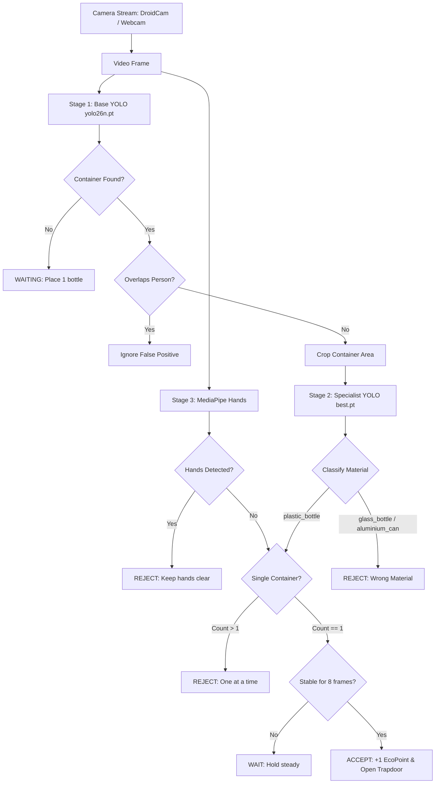

# GreenPoints AI - Smart AI-Based Plastic Bottle Recycling System

GreenPoints AI (EcoPoints) is an intelligent reverse vending machine (RVM) platform powered by computer vision. It inspects deposited containers in real time, verifies that the item is a valid recyclable plastic bottle, rejects other materials (glass bottles, aluminum cans), and uses hand-detection anti-fraud protection to ensure honest deposits before awarding points.

---

## Key Features

- **Two-Stage YOLO Neural Network Pipeline:**
  - **Stage 1 (Gatekeeper - `yolo26n.pt`):** Full-frame scanning to detect generic containers (`bottle`, `can`, `cup`, `wine glass`) and detect people to eliminate false positives (e.g., shirts or body parts detected as containers).
  - **Stage 2 (Specialist Classifier - `best.pt`):** Evaluates a cropped region of the candidate container to accurately classify the material into `plastic_bottle` (Accepted), `glass_bottle` (Rejected), or `aluminium_can` (Rejected).
- **MediaPipe Hands Anti-Fraud Protection:**
  - Real-time tracking of 21 3D hand landmarks.
  - Automatically freezes point distribution and locks the deposit trapdoor if human hands are detected holding or manipulating the item.
- **Robust Decision State Machine:**
  - **Anti-Flicker Stability:** Bottle must remain stable for multiple consecutive frames (`STABLE_FRAMES = 8`) before awarding points.
  - **Single Item Enforcement:** Rejects multiple items inserted simultaneously.
  - **Platform Reset Latch:** Requires the platform to be fully cleared (`MISS_LIMIT = 5`) before the next bottle can be scanned.
- **Multiple Camera Stream Options:**
  - Works with standard built-in or USB webcams.
  - Native support for **DroidCam** over Wi-Fi (stream directly from a smartphone camera) or via the DroidCam PC Virtual Webcam client.
- **Hardware Integration Ready:**
  - Simulated trapdoor motor timing (`DOOR_OPEN_DURATION`, `DOOR_CLOSE_DURATION`) with signals designed for serial integration with microcontrollers (ESP32 / Arduino).
- **Live Real-Time HUD Dashboard:**
  - Real-time user feedback showing accumulated points, trapdoor state, hand presence, and decision guidance banner.

---

## System Architecture



---

## Repository Structure

```text
├── weights/
│   ├── best.pt              # Fine-tuned YOLO model (v2) for material classification
│   └── yolo26n.pt           # Base YOLO model for container & person detection
├── test_custom_webcam.py    # Main EcoPoints vending machine application (HUD & logic)
├── predict_webcam.py        # Standalone webcam script to test YOLO detection directly
├── train_v2.py              # Transfer learning & fine-tuning script (v2 pipeline)
├── train_greenpoints.py     # Initial specialist model training script
├── eval_greenpoints.py      # Validation and evaluation script
├── old/                     # Archived legacy scripts (greenpoints.py)
├── requirements.txt         # Required Python dependencies
├── .gitignore               # Ignored files (datasets, runs, logs, virtual environments)
└── README.md                # Project documentation
```

---

## Installation & Setup

### 1. Clone the Repository

```bash
git clone https://github.com/piyushshrestha55/GreenPoints---Smart-AI-based-Plastic-Recycling-System.git
cd GreenPoints---Smart-AI-based-Plastic-Recycling-System
```

### 2. Create and Activate a Virtual Environment

**Windows (PowerShell):**
```powershell
python -m venv .venv
.\.venv\Scripts\Activate.ps1
```

**macOS / Linux:**
```bash
python3 -m venv .venv
source .venv/bin/activate
```

### 3. Install Dependencies

```bash
pip install -r requirements.txt
```

---

## Running the Application

### Option A: Using DroidCam via Wi-Fi (Smartphone Camera)
1. Install and launch the **DroidCam** app on your smartphone.
2. Note the Wi-Fi IP address shown in the app (e.g. `192.168.1.50`).
3. Run the script passing your phone's IP:
   ```bash
   python test_custom_webcam.py 192.168.1.50
   ```
   *(Alternatively, update `DROIDCAM_IP` inside `test_custom_webcam.py`)*.

### Option B: Using Built-in / USB Webcam
Run the script with your camera index (e.g., `0` for default laptop webcam, or `1` for external/virtual webcam):
```bash
python test_custom_webcam.py 0
# or
python test_custom_webcam.py 1
```

### Option C: Quick Model Verification (Standalone Predictor)
To quickly test the raw detection predictions of `best.pt` without the HUD and anti-fraud state machine:
```bash
python predict_webcam.py
```

### Controls
- Press **Q** in the camera window to safely quit the program.

---

## Training & Fine-Tuning Pipeline

### v2 Transfer-Learning Fine-Tuning (`train_v2.py`)
To adapt the detector to new webcam lighting conditions and real-world camera angles while retaining previous learning:
- **Base Checkpoint:** Boots directly from previously trained weights (`weights/best.pt`).
- **Dataset:** Combines the core 1,100 dataset images with real-world augmented webcam samples (`datasets/greenpoints_v2/data.yaml`).
- **Optimization Strategy:**
  - Conservative base learning rate (`lr0 = 0.0001`) to eliminate catastrophic forgetting.
  - Early stopping with patience (`patience = 15`) across 50 epochs.
  - Disk-backed feature caching and GPU multi-threading (`batch = 16`, `workers = 4`).

Run fine-tuning:
```bash
python train_v2.py
```

---

## Models & Weights

- **`weights/best.pt`**: Latest **v2 fine-tuned YOLO model** specialized for material identification:
  - Classes: `plastic_bottle` (Accepted), `glass_bottle` (Rejected), `aluminium_can` (Rejected)
  - Performance: **~99.2% mAP@50**, **99.0% Precision**, **98.2% Recall**
  - Robust against challenging webcam glare, labels, and varied container angles.
- **`weights/yolo26n.pt`**: Base lightweight YOLO model for initial container gatekeeping and human presence/false-positive filtering.

Both model weights are stored in the `weights/` directory and are ready for deployment without extra downloads.

---

## License & Project Status

Student Prototype & Capstone Project — Designed for sustainable smart city reverse vending machine infrastructure.
